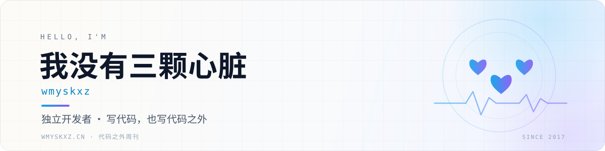

<picture>
  <source media="(prefers-color-scheme: dark)" srcset="./assets/banner-dark.svg">
  
</picture>

  <strong>独立开发者 · 写代码，也写代码之外</strong>

  
  
  
  

## 关于我

96 年的独立开发者，经营着一家小游戏工作室，平时远程办公。

喜欢把复杂的事情讲清楚，也喜欢记录代码之外的世界。每周一早上 07:30，会在博客更新一期「代码之外周刊」，分享一周里觉得有收获或有趣的内容。

- 🎮 目前在折腾：游戏、独立产品，以及一些不务正业的想法
- ✍️ 持续更新：[代码之外周刊](https://wmyskxz.cn/wiki/weekly/)（已更新 190+ 期）
- 🌱 正在练习：把想法写下来，把日子过具体

**常用技术**：`Java` · `Spring Boot` · `MySQL` · `Vue` · `Node.js` · `Hexo`

## 精选项目

| 项目 | 简介 | 技术 |
| :--- | :--- | :--- |
| **[MoreThanJava](https://github.com/wmyskxz/MoreThanJava)** · ⭐ 485 | 学习，不止 Code。Java 进阶与面试知识整理 | `Java` |
| **[Tmall_SSM](https://github.com/wmyskxz/Tmall_SSM)** · ⭐ 685 | 仿天猫商城的 SSM 全栈实战项目 | `Java` `SSM` |
| **[MyBlog](https://github.com/wmyskxz/MyBlog)** · ⭐ 366 | Spring Boot + Bootstrap 的个人博客系统 | `Java` `Spring Boot` |
| **[weekly](https://github.com/wmyskxz/weekly)** · ⭐ 54 | 代码之外周刊（内容已迁移至博客） | `Markdown` |

## 代码之外周刊

> 代码可以构建世界，但生活中的乐趣远不止于此。

每周一 07:30，分享一周里值得读的文章、值得知道的事，以及一些胡思乱想。

[阅读周刊合集 →](https://wmyskxz.cn/wiki/weekly/)

## GitHub

  <picture>
    <source media="(prefers-color-scheme: dark)" srcset="https://github-readme-stats.vercel.app/api?username=wmyskxz&show_icons=true&hide_border=true&include_all_commits=true&count_private=false&locale=cn&theme=github_dark&bg_color=00000000&title_color=38BDF8&icon_color=A78BFA&text_color=94A3B8">
    
  </picture>
  <picture>
    <source media="(prefers-color-scheme: dark)" srcset="https://github-readme-stats.vercel.app/api/top-langs/?username=wmyskxz&layout=compact&hide_border=true&langs_count=6&hide=html,css,scss&locale=cn&theme=github_dark&bg_color=00000000&title_color=38BDF8&text_color=94A3B8">
    
  </picture>

## 找到我

- 博客：[wmyskxz.cn](https://wmyskxz.cn)
- 周刊：[代码之外周刊](https://wmyskxz.cn/wiki/weekly/)
- RSS：[订阅更新](https://wmyskxz.cn/atom.xml)
- 公众号：我没有三颗心脏

  

  “代码可以构建世界，但生活中的乐趣远不止于此。”

